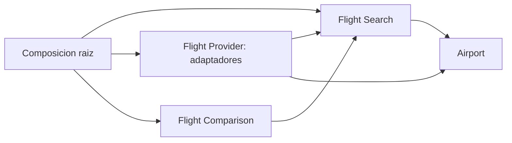

# Módulos y persistencia

**Límites aceptados en AIR-010 y contratos ratificados en AIR-012.** [NORMALIZED_CONTRACTS.md](NORMALIZED_CONTRACTS.md) fija los tipos compartidos y [API_DESIGN.md](../api/API_DESIGN.md) los DTO HTTP. Se conserva un solo backend Java 21/Spring Boot. La estructura siguiente se materializará cuando existan componentes autorizados.

## Dependencias permitidas

Las flechas representan dependencias de código previstas, no llamadas remotas.



Search posee el puerto `FlightProvider`; las implementaciones dependen de él. La composición raíz las conecta por inyección: Search nunca importa un adaptador concreto. Comparison usa modelos/casos públicos de Search, que no conocen Comparison. Ningún módulo accede a internos o repositorios de otro.

## Airport

- **Responsabilidad/casos:** resolver y listar aeropuertos del catálogo demo; validar códigos, distinguir aeropuerto y ciudad informativa.
- **Conceptos:** `Airport`, código normalizado y zona horaria; no entidad City independiente.
- **Interfaces públicas conceptuales:** `listAirports`, `findAirport`; referencia mínima y versión de catálogo.
- **Dependencias:** ninguna de otros módulos de negocio. Prohibido depender de Search, Comparison, resultados o credenciales de proveedor.
- **Persistencia:** recurso pequeño versionado y leído en memoria; ninguna tabla inicial.
- **Riesgos:** licencia/calidad del catálogo, códigos desconocidos, zonas incompletas y expansión implícita por ciudad; no inventar metadatos.

## Flight Search

- **Responsabilidad/casos:** validar consulta canónica, planificar fuentes/orígenes soportados, buscar, normalizar, filtrar/ordenar/paginar y conservar parciales.
- **Conceptos:** solicitud, segmento, trayecto, itinerario, oferta, observación de precio, dinero, procedencia y resultados por fuente/origen.
- **Interfaces públicas:** `searchFlights`, contrato normalizado y puerto `FlightProvider` con capacidades/resultados. Permitir reconstruir selecciones demo sin consultar una fuente externa.
- **Dependencias:** API pública de Airport. Prohibido importar adaptadores concretos, DTO externos o Comparison; el dominio no depende de JPA, Spring ni HTTP.
- **Persistencia:** solicitudes/resultados transitorios; ningún historial, oferta o snapshot durable inicial.
- **Riesgos:** inventar itinerarios a partir de tarifas parciales, deduplicar mal, mezclar ámbitos monetarios y confundir fallo/vacío.

## Flight Provider

- **Responsabilidad/casos:** adaptadores independientes demo y futuros Travelpayouts/SerpApi; traducción, capacidades, errores y datos temporales internos.
- **Conceptos:** implementación del puerto, capacidades y errores sanitizados; no entidad JPA ni dominio paralelo de ofertas.
- **Interfaces públicas:** implementación de `FlightProvider`; no exponer DTO, URLs autenticadas ni tokens al navegador u otros módulos.
- **Dependencias:** contratos públicos de Search y resolución de Airport cuando se necesite. Prohibido usar Comparison o sustituir fallos por demo.
- **Persistencia:** fixtures demo versionadas; ninguna retención de datos reales aprobada. Contadores técnicos futuros solo ante integración/despliegue autorizados.
- **Riesgos:** capacidades distintas, flujos de varias llamadas, cuotas y derechos de uso. Adaptadores reales sin implementar.

## Flight Comparison

- **Responsabilidad/casos:** validar selección, formar grupos compatibles, ordenar con preferencias por operación y explicar diferencias/subtotales conocidos.
- **Conceptos:** `GroundTransportEstimate`, preferencias transitorias y `ComparisonResult`.
- **Interfaces públicas:** `compareFlights` con consulta base, versión, IDs y estimaciones explícitas; reconstruir mediante Search, sin confiar precios de React.
- **Dependencias:** modelos/casos públicos de Search. Prohibido llamar a proveedores reales, modificar ofertas, acceder a BD ajena o inventar FX/equipaje.
- **Persistencia:** ninguna; selección/preferencias en operación/UI, sin localStorage obligatorio de búsquedas.
- **Riesgos:** desconocido como cero, mezcla de monedas, ida frente a ida/vuelta y subtotal presentado como total; reglas en [TRAVEL_COST_ENGINE.md](TRAVEL_COST_ENGINE.md).

## Límites que no justifican otro módulo

User y Favorites se aplazan por su coste en identidad, autorización y privacidad. Security es transversal en API/infraestructura. Shared/Common no se crea: `Money` y modelos de búsqueda/comparación pertenecen al contrato público de Search. City o Airline independientes se revisarán ante casos reales.

Dominio contiene reglas/valores; aplicación coordina; infraestructura adapta; API transfiere HTTP. Separar donde haya comportamiento o fronteras reales, sin exigir cuatro carpetas por módulo, interfaces vacías ni repositorios sin almacenamiento.

## Persistencia aprobada: ninguna BD de negocio inicial

Fixtures demo, catálogo y metadatos se versionarán como recursos mínimos en tareas posteriores; no copias de PoC privadas. Solicitudes, resultados, precios, segmentos, preferencias, errores y estimaciones no son entidades JPA por defecto. No guardar direcciones privadas ni texto libre innecesario.

JPA, Flyway y PostgreSQL están declarados, pero no justifican tablas. AIR-011 verificó el contexto de test sin DataSource mediante exclusión local a esa prueba; no verificó integración con persistencia ni el arranque de ejecución demo. Cambiar configuración de ejecución requiere tarea autorizada. **Migraciones iniciales necesarias: cero**; no crear V1 vacía ni configurar PostgreSQL por portfolio.

| Necesidad posterior posible | Modelo/consulta que podría justificarla | Condición previa |
|---|---|---|
| Catálogo grande o editable | Airport con ID estable y código único cuando exista; índice único para consulta exacta | Consulta/volumen/licencia aprobados; evaluar búsqueda por nombre antes de otros índices |
| Favoritos | Relación propietario–favorito y consulta por propietario; referencia o snapshot según caso | Aprobar cuentas, autorización y conservación; sin esquema anticipado |
| Historial/observaciones | Sin tabla aprobada; origen, ámbito, tiempos y borrado serían obligatorios | AIR-019 debe permitir retención/reutilización, incluida caché transitoria |
| Presupuesto técnico | Reservas/contadores atómicos; durabilidad si despliegue lo exige | Integración y concurrencia autorizadas; separado del dominio de vuelos |

Si se aprueba persistir el catálogo, la primera migración contendrá solo invariantes e índices justificados y se nombrará tras revisar migraciones existentes. AIR-017 concretará o ratificará el aplazamiento; no queda ejecutada. No diseñar ahora tablas de ciudades, ofertas, búsquedas o usuarios futuros.

## Estructura inicial de paquetes propuesta en AIR-012

Árbol documental bajo com.airwise.backend:

```text
airport/
  domain/                  Airport y referencias válidas
  application/             lectura de catálogo
flightsearch/
  domain/                  consulta, dinero, tiempos, itinerarios y resultados
  application/             búsqueda, normalización y puertos
flightprovider/
  demo/                    implementación y fixtures, cuando se autorice
flightcomparison/
  domain/                  criterios, estimaciones y resultado
  application/             reconstrucción y comparación
api/
  demo/                    controladores, DTO HTTP y mapeos, cuando se autoricen
```

Los adaptadores HTTP transversales dependen de las APIs públicas de los cuatro módulos y del registro demo conectado en la composición raíz. El endpoint de catálogo puede combinar Airport con metadata DatasetDescriptor sin introducir dependencia de Airport hacia Search. api/demo es una frontera del proceso, no un quinto módulo de negocio. La composición raíz sigue en el proyecto existente.

Los objetos de dominio carecen de anotaciones de Spring/JPA. Los DTO mantienen el contrato JSON y se mapean en API. Las fixtures pertenecen al adaptador demo. Si más adelante existe persistencia, sus entidades y repositorios quedarían en infraestructura del módulo que posea ese caso durable.

## Orden de implementación posterior

1. Implementar valores Airport/Money/consulta y catálogo mínimo, con invariantes y tests puros.
2. Crear puerto y adaptador demo con un caso vertical de ida directa, resultado normalizado, reloj y versión.
3. Completar ida/vuelta, varios orígenes, segmentos/conexiones, identidad y estados difíciles para satisfacer toda AIR-013.
4. Exponer catálogo y búsqueda con filtros/orden/página en AIR-014, tras la preparación de seguridad prevista.
5. Implementar comparación en AIR-015 y preparación de UI en AIR-018.

Los contratos de comparación se fijan ahora para evitar decisiones de DTO incompatibles. Su código puede esperar. Las clases, directorios y adaptadores reales no se crean por adelantado. Los incrementos técnicos no permiten cerrar AIR-013 con solo el primer caso simple.
