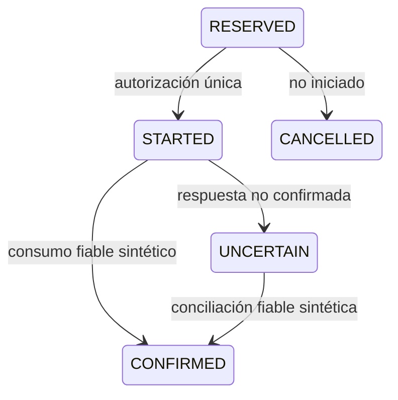

# Núcleo de admisión sintético — AIR-021

Promoción autorizada de IMP-008,19/11/2026. Componente Java independiente en `flightprovider.admission`, sin Spring bean, endpoint, transporte, credenciales ni dependencia de Travelpayouts/SerpApi. No está conectado al buscador demo. Estado de implementación/verificación en [VALIDATION](../developer-guide/VALIDATION.md); límites decididos en [ADR-0008](../decisions/0008-synthetic-admission-ledger.md).

AIR-021 completada: cinco fuentes, cuatro clases de pruebas y42casos nuevos; regresión limpia280/0fallos/0errores/0omitidas. No añade capacidad operativa de un proveedor real.

| Contrato implementado | Responsabilidad |
|---|---|
| `AdmissionModel` | Valores inmutables de política, fases, evidencia, decisión y handle opaco de reserva |
| `FlowEstimator` | Máximo acotado de intentos/créditos de un plan, sin transporte |
| `AdmissionLedger` | Puerto de operaciones atómicas y cierre conservador compartido |
| `InMemoryAdmissionLedger` | Ledger volátil con límites/estados; exclusivamente escenario sintético compartido |
| `AdmissionService` | Reloj/alcance, acceso serializado y denegación sanitizada ante fallo |

## Contrato y responsabilidad

El modelo separa identificadores no secretos de proveedor/cuenta/operación, alcance de ejecución, coste monetario, créditos abstractos e intentos. Créditos no son euros, personas, ofertas o `requiredUnits` de búsqueda. Solo coste explícito conocido exactamente0€ es admisible; desconocido, distinto de cero o estimación inválida no habilitan consumo.

Un plan contiene fases ordenadas y cantidades máximas; el estimador suma/multiplica con comprobación de overflow y expansión acotada a256pasos. Por ejemplo, tres iniciales más regreso/vendedor de una alternativa requieren cinco intentos; el flujo completo por cada uno de tres orígenes requiere nueve. No se prometen datos ni se ejecutan búsquedas por hacer el cálculo.

La política sintética es inmutable. Aplica simultáneamente límites de intentos/créditos diarios y mensuales por operación, proveedor y cuenta, además del máximo por flujo y de flujos concurrentes/globales. Una operación no obtiene saldo independiente duplicado por pertenecer a otro grupo. Cuenta es un identificador interno de agregación, nunca una clave; cualquier agrupación entre proveedores requiere unidades abstractas compatibles y aprobación explícita, sin conversión monetaria.

El ledger nace sin evidencia de presupuesto. Su inicialización explícita es para un escenario sintético nuevo, no una recuperación; no puede resetear reservas o uso. La evidencia de saldo tiene observación, caducidad y periodo comercial. Actualizarla no elimina débitos previos, no regenera reservas ni demuestra renovación del proveedor.

## Reserva y pasos

1. Estimar el flujo completo y denegar alcances no admitidos o costes/cuotas desconocidos antes de conceder un permiso.
2. Reservar de manera atómica todos sus compromisos de operación/proveedor/cuenta y concurrencia bajo el mismo ledger. La reserva es completa o no existe; no se autoriza un prefijo que simule garantizar todo el viaje.
3. Antes de cada paso, consumir su autorización una sola vez y en orden. Revalidar salud, reloj, evidencia y ventana/periodo de la reserva. Un identificador externo no crea una reserva: sus handles pertenecen a la instancia/epoch que los emitió.
4. Tras marcar inicio, confirmar consumo fiable dentro de lo reservado o declarar incertidumbre. Un intento iniciado no se devuelve por error, caché, cancelación o timeout. Solo crédito comercial potencial puede conciliarse con evidencia explícita fiable, sin doble devolución.
5. Cancelar únicamente pasos inequívocamente no iniciados. Repetir requiere nueva admisión/presupuesto; no hay reintentos, polling, renovación o fallback automáticos.

Estados de pasos implementados: reservado, iniciado, confirmado, incierto o cancelado antes del inicio. Un fallo se expresa mediante códigos sanitizados, sin propagar mensajes de un doble. El puerto exige fallo atómico o cierre compartido antes de exponer efecto indeterminado; solicitar cierre después de una excepción no sustituye esa obligación. Un futuro almacenamiento que no la cumpla no es apto.

Cancelar un paso impide iniciar fases posteriores que exigían su confirmación; cancelar también las restantes libera únicamente compromisos inequívocamente no iniciados.

El componente **no ejecuta callbacks ni envíos**: autoriza pasos sintéticos y mantiene su contabilidad. Las pruebas usan marcadores/dobles tras una autorización satisfactoria. Esto acredita reglas de admisión, no la seguridad de un transporte real que todavía no existe.

`confirm(..., consumedCredits)` recibe una afirmación fiable del llamante sintético; no comprueba recibos del proveedor ni realiza consultas de saldo. No usar esta operación como prueba de conciliación real. La fiabilidad de evidencia externa y el acoplamiento transaccional con un futuro transporte permanecen pendientes.

## Tiempo e incertidumbre

Ventanas propias de día y mes natural UTC mediante reloj inyectable, separadas del ciclo comercial. Retroceso del reloj cierra el ledger; evidencia caducada o periodo incoherente impiden iniciar pasos. Un paso reservado en otra ventana no se migra automáticamente: se deniega y conserva su compromiso hasta cancelación explícita de pasos no enviados o conciliación fiable de los iniciados.

Reservas pendientes/iniciadas/inciertas no desaparecen al cambiar día/mes. Los consumos confirmados pertenecen a su ventana original. La deuda comercial se conserva durante toda la vida del escenario, salvo conciliación explícita permitida: es deliberadamente conservadora y puede denegar de más al actualizar saldo/periodo. **No implementa reposición comercial real** ni infiere que un saldo observado no incluya operaciones ya comprometidas.

Historial de reservas acotado a10000entradas, sin expulsarlas para obtener cuota nueva. Al agotarlo se deniega; no es una política de conservación real de datos. No hay límites técnicos por minuto/hora implementados en este incremento: deben añadirse/probarse cuando se acuerde un control durable para uso real.

## Garantías y escenarios bloqueados

| Escenario | Garantía disponible |
|---|---|
| Dos solicitudes por la última unidad, mismo ledger | Comprobación y reserva atómicas; una sola puede obtener esa unidad |
| Dos servicios que comparten la misma instancia | Coordinación por la sección crítica del ledger, no por locks de servicio separados |
| Dos instancias de ledger para una cuenta | No coordinan; alcance de múltiples ledgers rechazado, sin promesa de detección global de objetos independientes |
| Timeout o resultado indeterminado después de inicio | Reserva/crédito conservados; no reenvío o devolución automática |
| Fallo de ledger | Denegación/cierre conservador; no continuar con permiso supuesto |
| Reinicio o crash con memoria perdida | No hay recuperación durable; nueva instancia desconoce la anterior y handles viejos no son válidos |
| Varios procesos/réplicas o ejecución real | Alcances rechazados; memoria no es control suficiente |
| Nueva ventana diaria/mensual | No elimina compromisos pendientes/inciertos ni renueva deuda comercial |

El llamante sintético declara su alcance; el componente no detecta topología, procesos o despliegues de forma autónoma. Mentir sobre el alcance o construir dos escenarios independientes no crea una garantía distribuida. No se expone como servicio de producción ni se registra en Spring para evitar confundirlo con autorización de proveedores reales.

## Persistencia y siguiente incremento

Database y DevOps deben revisar las afirmaciones de recuperación/topología; Security & QA, carreras, replay, ventanas y consumo incierto. Las pruebas ejecutadas y límites quedan en el registro de validación. No se crean tablas, entidades, Flyway, infraestructura, exportaciones de ledger ni caché de vuelos.

Siguiente decisión vinculada a AIR-017, sin iniciarla: especificar almacenamiento transaccional compartido, fencing/idempotencia, recuperación/conciliación, evidencia de saldo y pruebas de crash antes/después de commit. Si se autoriza, justificar nueva persistencia y dependencias; no introducir cuentas/BD de negocio por defecto. Los permisos Q-T/Q-S y demás condiciones de [AIR-019](../api/PROVIDER_ASSESSMENT.md) siguen pendientes. Este núcleo no los resuelve ni habilita APIs reales.
